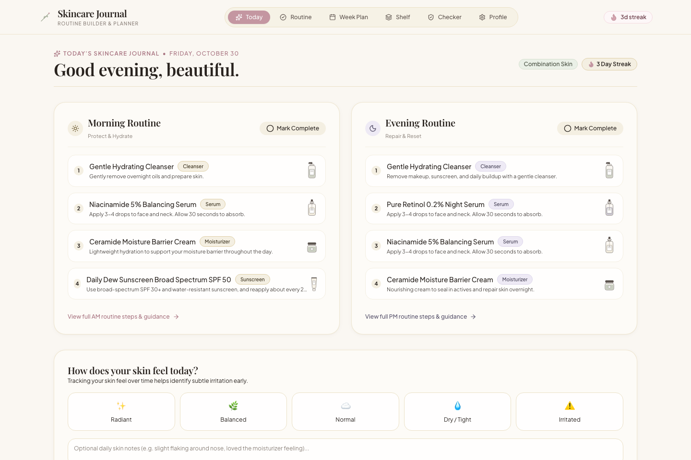
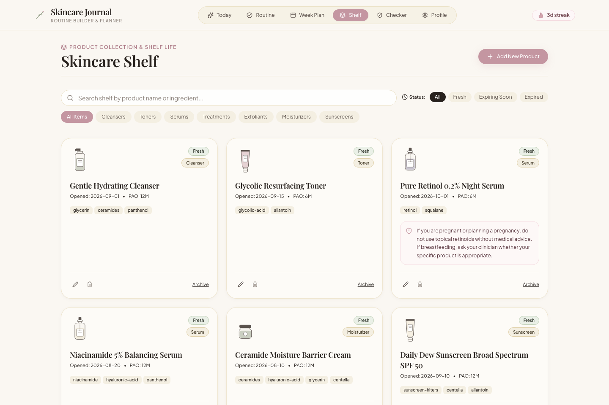
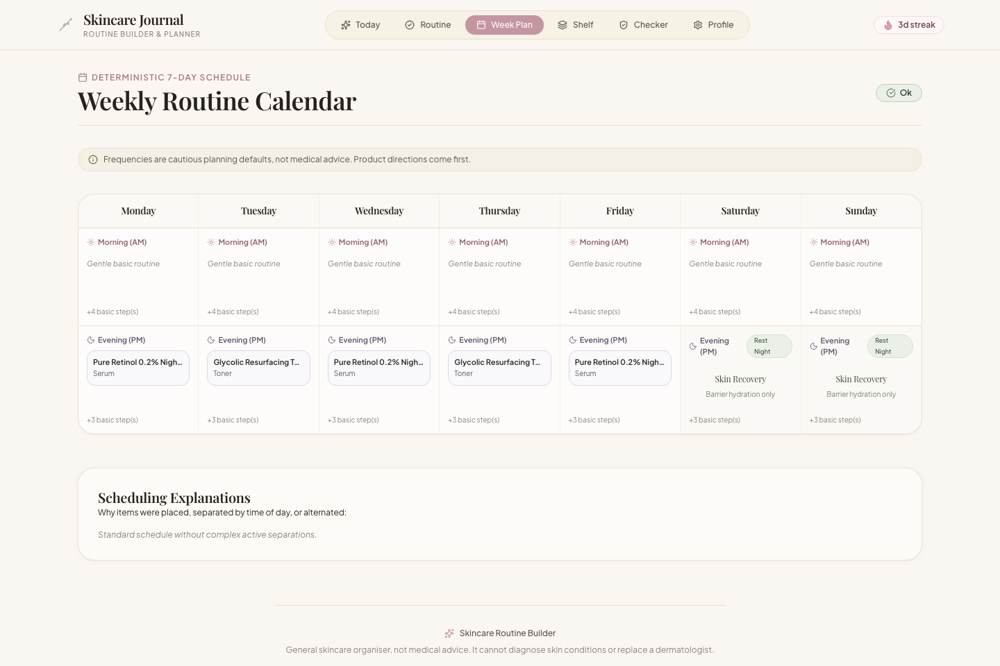
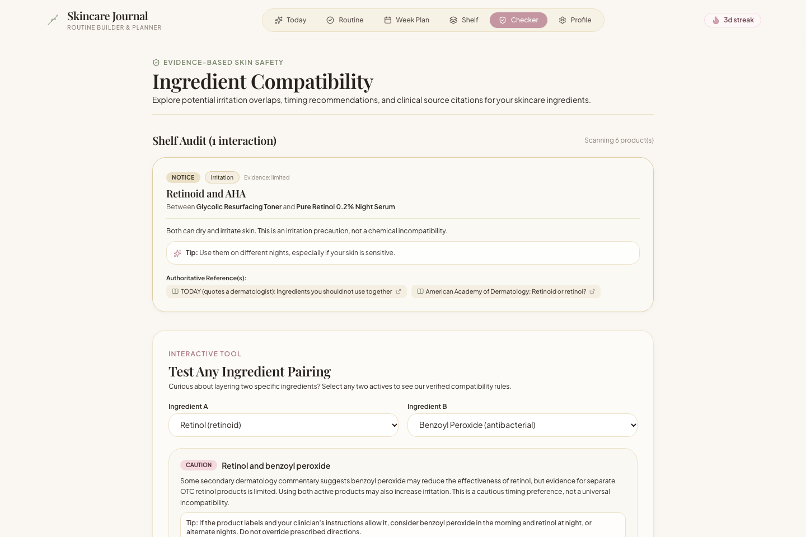
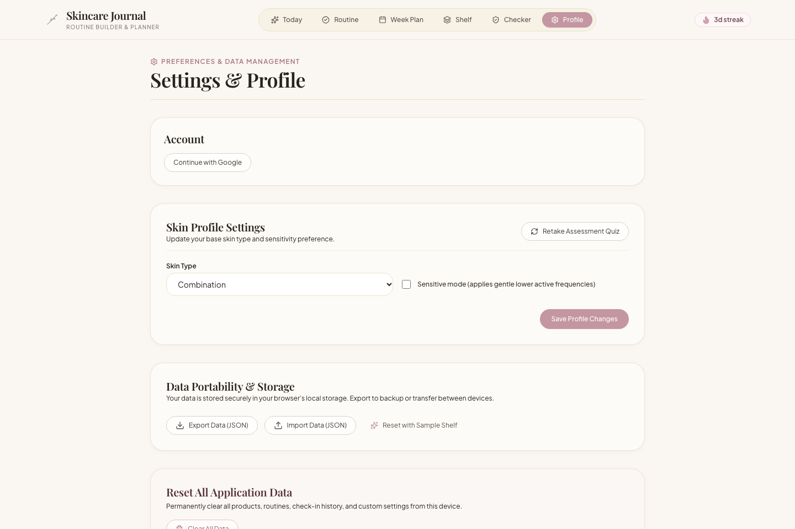

# 🌸 Skincare Routine Builder

An editorial, evidence-informed web application and daily skincare journal designed to help users organize their skincare shelf, understand ingredient interactions, build morning and evening routines, and generate a deterministic 7-day schedule for strong active ingredients.

[-3178C6?logo=typescript&logoColor=white)](https://www.typescriptlang.org/)
[](https://react.dev/)
[](https://firebase.google.com/)
[](https://vitest.dev/)
[](LICENSE)

---

## 🔗 Live Application & Demo

- **Live Application:** [https://vrushtii-patel.github.io/Skincare-Routine-Builder/](https://vrushtii-patel.github.io/Skincare-Routine-Builder/)
- **Source Repository:** [https://github.com/Vrushtii-Patel/Skincare-Routine-Builder](https://github.com/Vrushtii-Patel/Skincare-Routine-Builder)
- **Instant Demo:** Launch with a pre-configured sample shelf and routines by appending `?demo=1` to the welcome URL: [`/welcome?demo=1`](https://vrushtii-patel.github.io/Skincare-Routine-Builder/#/welcome?demo=1).

---

## 📸 Application Screenshots

### 1. Editorial 3D Landing Experience
*Recreating the full-viewport scroll story with a realistic Three.js 3D cosmetic serum bottle, soft-pink skincare palette, and high-resolution skincare active botanicals (Damask Rose, Centella Asiatica / Cica, Rose Petal, and Hydrating Aloe).*


---

### 2. Today's Skincare Journal & Routine Tracker
*Interactive morning and evening step completion, daily skin-feel logger, routine completion streaks, and contextual safety notices.*



---

### 3. Product Shelf & PAO Expiry Tracker
*Visual skincare vanity inventory tracking custom packaging forms (droppers, tubes, jars, pumps), active ingredient tags, open dates, Period After Opening (PAO), and batch expiration dates.*



---

### 4. Deterministic 7-Day Active Planner
*Explainable weekly schedule generator balancing potent actives, enforcing rest nights, separating time-of-day incompatibilities, and preventing consecutive retinoid use.*



---

### 5. Evidence-Based Ingredient Compatibility Matrix
*Interactive active pairing validator citing dermatology consensus, clinical evidence tiers, and conservative planning notes.*



---

### 6. Google Sign-In & Cloud Firestore Sync
*One-click Google authentication with real-time bidirectional Firestore cloud synchronization, manual sync triggers, and offline-first JSON export/import.*



---

## 🌸 Visual Aesthetic & Design Direction

"Modern feminine skincare journal meets premium beauty editorials."

- **Soft-Pink & Botanical Color Palette:**
  - Soft Blush / Pink Background: `#FBE8EE` (Hero: `#FFF1F4`, Light transition: `#F6DCE5`)
  - Dusty Rose: `#B96F87` (Contrast dark section & primary accent)
  - Cocoa Plum Ink: `#3D2630` (High-contrast typography)
  - Muted Plum: `#886875` (Editorial subtitles & metadata)
  - Rose Accent / Numbers: `#D88FA6` (Oversized section numerals & focus glows)
  - Muted Sage: `#919D85` (Balancing botanical green & completion state)
  - Warm Cream / White: `#FFF8F9` / `#FFFFFF` (Surface card backgrounds)
- **Typography:** Refined editorial headers (*Playfair Display*) and headline display typography (*Poppins*, weights 300 to 800) paired with clean, accessible interface typography (*Plus Jakarta Sans*).
- **Custom Illustrations & 3D:**
  - Realistic Three.js WebGL 3D glass serum bottle with physical volume transmission, internal dropper pipette, rose-gold metallic collar, silicone bulb, and luxury label.
  - Custom SVG illustrations for skincare packaging: droppers, jars, tubes, pumps, essence droplets, and botanical twigs.

---

## 🛠️ Architecture & Technology Stack

| Layer | Technology |
|---|---|
| **Framework** | React 18 + Vite |
| **Language** | TypeScript (Strict mode enabled, **100% strictly typed — zero `any`**) |
| **3D Rendering** | Three.js (WebGLRenderer, PBR Physical Materials, ACES Filmic Tone Mapping, RoomEnvironment) |
| **Styling** | Tailwind CSS + bespoke CSS modules (`melli.css`) with custom design tokens |
| **State Management** | Zustand with versioned `localStorage` persistence |
| **Authentication** | Firebase Authentication (One-click Google Sign-in popup) |
| **Cloud Synchronization** | Cloud Firestore (Real-time bidirectional document & subcollection sync) |
| **Date Arithmetic** | `date-fns` |
| **Icons** | Lucide Icons |
| **Celebration Motion**| `canvas-confetti` |
| **Testing** | Vitest + React Testing Library + JSDOM (**50 / 50 unit and integration tests passing**) |

---

## ☁️ Google Sign-In & Cloud Firestore Synchronization

The application is built on a **Local-First, Cloud-Synced** architecture designed for resilience and privacy:

### 1. One-Click Google Authentication
- Users can sign in instantly using their Google account via `signInWithPopup` (`src/services/auth.ts`).
- User profile data (name, email, avatar) is automatically surfaced in the navigation and settings pane.
- Signing out cleanly detaches the cloud listener while keeping the local shelf intact.

### 2. Bidirectional Cloud Firestore Sync
- Handled automatically via the `useCloudSync` hook (`src/hooks/useCloudSync.ts`) and Firestore services (`src/services/db.ts`):
  - **Auto-Sync on Change:** Any edit made to the user's profile, product shelf, or daily routine check-ins is automatically debounced and written to Firestore.
  - **Remote Pull on Login:** When signing in on a new device or browser, remote cloud routines and shelf products are automatically pulled and merged into local state.
  - **Subcollection Organization:**
    - `users/{uid}`: Profile data, experience level, skin concerns, and `updatedAt` server timestamp.
    - `users/{uid}/products/{productId}`: Individual skincare products with ingredient IDs, expiration dates, and custom directions.
    - `users/{uid}/checkins/{YYYY-MM-DD}`: Daily AM/PM routine check-off history and skin feel records.
  - **Manual Trigger & Status:** Real-time sync status ("Synced with Cloud", "Syncing...", or "Cloud sync paused") with a manual "Sync Now" button and timestamp in [Settings](file:///Users/vrushti/Downloads/Skincare%20Routine%20Builder/src/pages/Settings.tsx).

### 3. Graceful Offline Fallback & Data Portability
- **Zero Runtime Cloud Lock-in:** If `.env` credentials are not supplied or the device is offline, the entire application operates seamlessly with zero broken buttons or errors.
- **JSON Import / Export:** Users can export their complete skincare shelf, routines, and check-in history to a single human-readable `.json` file at any time, or restore it on any machine.

---

## 📁 Repository Structure & Separation of Concerns

```
reference/       Foundational audit documentation, master context, and reference tools
                 - MASTER_CONTEXT.md: Complete skincare science domain specification and rules
                 - ANTIGRAVITY_PROMPTS.md: Detailed prompt requirements and design goals
                 - AUDIT_REPORT.md: Pre-implementation audit and contradiction analysis
                 - validate.py: Python reference data consistency validator
                 - reference_scheduler_prototype.py: Illustrative Python scheduling prototype
                 - ingredients.json, conflicts.json, frequencies.json, sources.json: Original research files
public/          Static public assets
                 - assets/skincare/: Transparent skincare botanicals (damask-rose, cica-sprig, rose-petal, aloe-chamomile)
                 - screenshots/: Real, high-resolution application screenshots for documentation
src/
  data/          Static bundled JSON files (primary source of truth for the web app)
                 - ingredients.json, conflicts.json, frequencies.json, sources.json
  types/         Strict TypeScript domain interfaces and discriminated unions (zero any)
  lib/           Pure TypeScript business logic (no React, no clock access, 100% deterministic)
                 - validateData.ts: Strict validator ensuring integrity of ingredients, rules, and frequencies
                 - loadData.ts: Strongly-typed reference data loader and cache
                 - matchRules.ts: Specificity-based ingredient conflict matcher
                 - buildWeeklyPlan.ts: Deterministic weekly routine scheduling engine
                 - expiry.ts: Period After Opening (PAO) & batch expiry calculator
                 - streak.ts: Daily completion and streak calculation engine
                 - matchProducts.ts: Ordered routine slot builder & gap identifier
  store/         Zustand store with schema migration, local persistence, and cloud sync hooks
  services/      External services layer
                 - firebase.ts: Safe Firebase app initialization and environment check
                 - auth.ts: Google Sign-in and session management
                 - db.ts: Firestore batch read and write operations
  hooks/         React hooks deriving reactive state from lib/ and managing cloud synchronization
  components/    Presentation components
                 - layout/: Navbar, AppLayout
                 - skincare/: SerumBottle3D Three.js model & custom packaging SVGs
                 - safety/: Contextual medical disclaimers & caution banners
                 - shelf/: IngredientPicker, ProductFormModal
                 - ui/: Modal, Toast
  pages/         Welcome (3D Landing Experience), Quiz, Today, Routine, Shelf, Week, Compatibility, Settings
```

---

## 🧠 Scheduling Engine Mechanics

The TypeScript scheduling engine (`src/lib/buildWeeklyPlan.ts`) is deterministic, reproducible, and explainable:

1. **Units:** Evaluates products owning at least one `scheduled` active. Frequencies follow `frequencies.json` defaults (`sensitiveNights` for sensitive profiles) unless clinician-directed or label directions are entered.
2. **Hard Constraints:**
   - Clinician `fixedDays` are anchored exactly on specified days and never moved.
   - Products containing any ingredient in `profile.excludedIngredients` are never auto-scheduled and surface in `decisions`.
   - Prescription retinoids (e.g., tretinoin, tazarotene) without entered directions produce `NEEDS_CLINICIAN_DIRECTIONS` instead of an invented schedule.
   - Essential steps (cleanser, moisturizer, AM sunscreen) are never dropped.
3. **Time-of-Day Resolution:** Soft rules with `time-of-day` tactic separate compatible pairs between morning and evening (e.g., benzoyl peroxide moved to AM while retinol stays in PM).
4. **Greedy Placement with Lookahead Scoring:**
   - Candidate units are sorted by soft conflict degree descending, nights descending, maximum irritation potential descending, and product ID ascending.
   - Day selection minimizes `score = (penalty, activesAlreadyInSlot, dayIndex)`:
     - Conflict weight penalty from `frequencies.json`
     - Cross-product consecutive retinoid penalty (weight 3) across all products with a `retinoid` tag
     - Slot capacity penalty if slot already contains $\ge 2$ scheduled actives
5. **Rest Nights Preservation:** Counts PM nights without scheduled actives. If fewer than `restNightsMin` (2 nights), emits a `REST_NIGHTS_SHORT` warning.
6. **No Silent Drops:** Products and ingredients are never silently omitted. Explanations describe every time-of-day move, alternating schedule, and soft warning.

---

## 🧪 Scientific Evidence & Compatibility Decisions

- **Niacinamide + Vitamin C:** Deliberately left without a conflict warning in `conflicts.json` (`reviewedNoRule`). Quoted dermatological consensus describes the old "cannot mix" claim as a laboratory artifact of high temperatures and unformulated raw chemicals.
- **Vitamin C + Retinoid:** Separated by default via `preferredTime` (Vitamin C in AM, Retinoid in PM) rather than claiming a chemical incompatibility.
- **Retinol + Benzoyl Peroxide:** Rule `c01` is classified as `efficacy-timing` with `partial` evidence. Resolved by time-of-day separation (BPO in AM, Retinol in PM).
- **Adapalene + Benzoyl Peroxide:** Rule `c03` is classified as `info` with `enforcement: none` because the pair is an established prescription combination (e.g., Epiduo).
- **Conservative Planning Notes:** All rules lacking formal clinical citations (`evidence: insufficient`) are explicitly labelled in the UI with the prefix `"Conservative planning note:"` to prevent misleading medical claims.

---

## 🛡️ Safety Disclaimers

This application is an educational and organizational tool. It does not provide medical diagnoses, treatment plans, or drug dosage recommendations.

- Every page displays: *"General skincare organiser, not medical advice. It cannot diagnose skin conditions or replace a dermatologist."*
- Retinoid advisory: *"If you are pregnant or planning a pregnancy, do not use topical retinoids without medical advice. If breastfeeding, ask your clinician whether your specific product is appropriate."*
- Patch-testing advice reflects American Academy of Dermatology (AAD) recommendations (testing on inner forearm twice daily for 7–10 days).

---

## 🚀 Running the Application

### Prerequisites

- Node.js (v18+)
- npm (v9+)

### Installation & Development

```bash
# Clone the repository
git clone https://github.com/Vrushtii-Patel/Skincare-Routine-Builder.git
cd "Skincare Routine Builder"

# Install dependencies
npm install

# (Optional) Add your Firebase configuration keys to .env
cp .env.example .env

# Start local development server
npm run dev
```

### Running Automated Tests & Validation

```bash
# Run Vitest test suite (50 tests covering scheduler, rules, expiry, streak, and UI)
npm test

# Run Python reference data consistency validator
python3 reference/validate.py
```

### Production Build & Preview

```bash
# Type check with strict TypeScript and bundle for production
npm run build

# Preview production bundle locally
npm run preview
```

---

## 📄 License

This project is licensed under the [MIT License](LICENSE).
